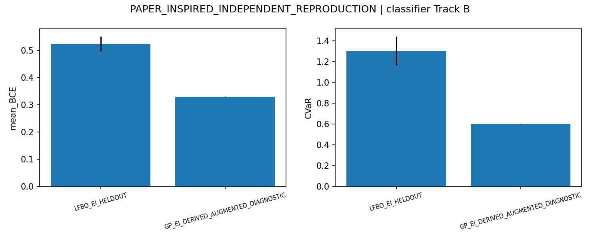

# LFBO + GP — Forrester experiments

Phần thực nghiệm của Phước: so sánh **LFBO-EI** (Random Forest 1.000 cây) và **GP regression** (Constant × Matérn 5/2) trên Forrester. Pipeline chính là unified Track B: 100 family độc lập, seeds 44–143, mỗi family có 200 tasks và 32 quan sát/task, chia raw train/validation 26/6 trước augmentation.

Metric là **Weighted BCE theo task**, chia cho số augmented validation rows; CVaR₀.₈ lấy 39 task losses lớn nhất trong mỗi family. Bảng cuối lấy mean ± sample SE trên 100 family metrics. GP dùng `q = EI_tau / (EI_tau + U_train)`; đây là evaluator suy diễn của nhóm, **chưa được tác giả xác minh**. Kết quả mang nhãn `PAPER_INSPIRED_INDEPENDENT_REPRODUCTION / NOT_PAPER_EQUIVALENT`, không phải tái lập chính xác Table 1.

## Kết quả: Paper và thực nghiệm của Phước

Run **`unified-b-full100-20261114`**: **100 family độc lập × 200 tasks = 20.000 tasks/phương pháp** (40.000 task losses cho LFBO + GP), seeds 44–143. Kết quả của nhóm được trình bày dưới dạng **mean ± SE trên 100 family**, không phải sai số trên 20.000 tasks.

| Thuật toán | Paper — Average Loss ↓ | Thực nghiệm của Phước — Weighted BCE ± SE ↓ | Paper — CVaR ↓ | Thực nghiệm của Phước — CVaR₀.₈ ± SE ↓ |
|---|---:|---:|---:|---:|
| LFBO | 0.5823 | 0.523973 ± 0.027310 | 0.9876 | 1.303971 ± 0.138380 |
| GP | 0.7891 | 0.328993 ± 0.001370 | 1.3245 | 0.600549 ± 0.002292 |

**Trạng thái: `NOT_PAPER_EQUIVALENT`.** Số liệu paper là giá trị tham chiếu Table 1, còn số liệu thực nghiệm được đọc từ `summary.json` của run đã hoàn thành; đây là classifier loss, không phải normalized regret sau BO. Phía tác giả đã xác nhận Weighted BCE theo task và CVaR trên task losses, nhưng đầy đủ protocol Table 1 chưa được xác minh. Nhóm dùng held-out 26/6, seeds cố định và GP evaluator suy diễn `EI/(EI+U_train)` (`GROUP_DERIVED_EVALUATOR / NOT_AUTHOR_VERIFIED`). Vì vậy không dùng bảng này để kết luận GP/LFBO của nhóm vượt paper.

Dữ liệu kết quả đã đưa lên GitHub tại [results/published/lfbo-gp-full100-20261114/](results/published/lfbo-gp-full100-20261114/):

- [summary.json](results/published/lfbo-gp-full100-20261114/summary.json): kết quả tổng hợp chính xác chưa làm tròn; [config.json](results/published/lfbo-gp-full100-20261114/config.json): cấu hình gốc v1 và số tham chiếu paper.
- [task_losses.csv](results/published/lfbo-gp-full100-20261114/task_losses.csv): đủ 40.000 task losses; [run_metrics.json](results/published/lfbo-gp-full100-20261114/run_metrics.json): metrics của 100 family; [paired_task_differences.csv](results/published/lfbo-gp-full100-20261114/paired_task_differences.csv): so sánh từng task.
- [logs/](results/published/lfbo-gp-full100-20261114/logs/): log chạy gốc, kiểm tra full archive và đối chiếu PyTorch; [environment.json](results/published/lfbo-gp-full100-20261114/environment.json): môi trường thực tế.
- [publication_manifest.json](results/published/lfbo-gp-full100-20261114/publication_manifest.json): SHA256, nguồn từng file và phạm vi công bố.



Bộ công bố khoảng 6,3 MB, chép nguyên byte từ kết quả đã lưu, không chạy lại benchmark. Raw observations/predictions và snapshot đầy đủ khoảng 1,45 GB vẫn ở local. Bộ này đủ đối chiếu task → family → summary; không đủ kiểm tra lại BCE từng prediction hoặc resume. `logs/verify.log` là bằng chứng đã kiểm tra archive gốc, không phải chứng nhận bộ công bố chứa toàn bộ archive. Báo cáo Markdown trung gian và ZIP không được đưa lên Git.

## Cài đặt Ubuntu

Runtime được khóa ở **Python 3.12.14**; kiểm tra `python3.12 --version` trước khi tạo môi trường. Dependencies CPU nằm trong `requirements.txt`; không cần checkpoint hoặc dịch vụ bên ngoài.

```bash
python3.12 -m venv .venv
.venv/bin/python -m pip install -r requirements.txt
python3 -B main.py --mode preflight
```

## Chạy bằng terminal

Chọn run ID mới để giữ nguyên kết quả trước. Không có thực nghiệm nào tự chạy khi gọi help hoặc preflight.

```bash
python3 -B main.py --help
python3 -B -u main.py --mode smoke --run-id lfbo-gp-smoke-user --workers 1
python3 -B -u main.py --mode family --run-id lfbo-gp-family200-user --workers 1

# 100 family × 200 tasks: 20.000 fits cho mỗi phương pháp.
python3 -B -u main.py --mode full --run-id lfbo-gp-full100-user --workers 2 \
  --confirm-full --acknowledge-independent-protocol

python3 -B -u main.py --mode resume --run-id lfbo-gp-full100-user --workers 2 \
  --confirm-full --acknowledge-independent-protocol
```

## Xem kết quả đã lưu

```bash
python3 -S -B main.py --mode show --run-id lfbo-gp-full100-user
python3 -S -B main.py --mode compare --run-id lfbo-gp-full100-user
python3 -S -B main.py --mode verify --run-id lfbo-gp-full100-user
```

Các lệnh này chỉ đọc và kiểm tra dữ liệu, không training/inference/objective. Thiếu dữ liệu sẽ báo lỗi, không sinh số liệu mới. Kết quả lưu local tại `results/lfbo_gp_unified/<run-id>/`: config/source snapshots, seeds, raw observations/predictions, task/family metrics, CSV, JSON, logs và biểu đồ. Báo cáo trung gian và raw archive đầy đủ giữ local; bộ kết quả công bố được liệt kê ở bảng và đường dẫn phía trên.

Bản code xuất bản dùng `configs/lfbo_gp_unified/protocol_v2.json`. Các tham số khoa học, seed và split giữ nguyên v1; đường dẫn nguồn và source lineage được tách lại cho clone mới. Máy đang giữ archive v1 đầy đủ có thể xem/verify bằng snapshot gốc, ví dụ:

```bash
python3 -S -B main.py --mode compare --run-id unified-b-full100-20261114
```

V1 chỉ đọc dưới code v2. Muốn resume v1 phải dùng đúng code/runtime v1; không sửa protocol lock cũ để vượt kiểm tra. Clone mới có bộ kết quả công bố ở `results/published/`, nhưng không kèm archive v1 đầy đủ. Lệnh `main.py --mode compare/show/verify` phía trên yêu cầu archive đầy đủ; xem trực tiếp CSV/JSON được liên kết trong README để đọc kết quả đã công bố.

## Kiểm thử

```bash
.venv/bin/python -B -m pytest
```

Tests dùng fixture nhỏ, không chạy benchmark full100. Kiểm tra số học PyTorch/source AST là tùy chọn, trong môi trường CPU Python 3.11 riêng:

```bash
python3.11 -m venv .venv-torch
.venv-torch/bin/python -m pip install -r requirements-torch-check.txt
.venv-torch/bin/python -B -m pytest tests/test_lfbo_gp_unified_torch.py
```

Nguồn tham chiếu và licenses giữ tại `vendor/`; xem `NOTICE` và `LICENSE`. Email, ảnh trao đổi và báo cáo kiểm toán cá nhân chỉ giữ local.
