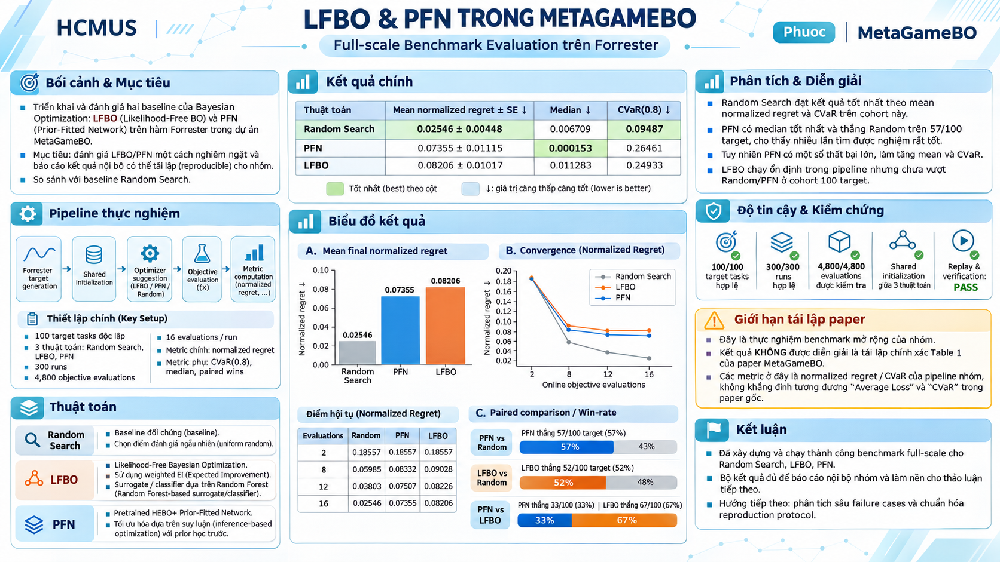
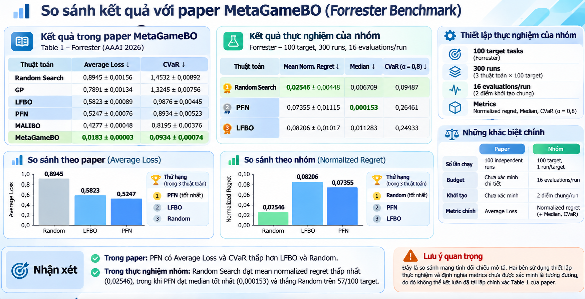

# MetaGameBO_review — thực nghiệm LFBO và PFN

Phần thực nghiệm của **Phước** trong đồ án tổng quan MetaGameBO, môn Nhập môn Học máy: so sánh **Random Search, LFBO-EI và PFNs4BO pretrained** trên benchmark Forrester.

## Poster báo cáo



[Xem poster kích thước đầy đủ](assets/lfbo-pfn-forrester-poster.png).

### Đối chiếu với kết quả trong paper



[Xem ảnh so sánh kích thước đầy đủ](assets/metagamebo-paper-group-comparison.png). Thiết lập và định nghĩa metrics của hai bên chưa được xác minh tương đương; đây là đối chiếu mô tả.

## Dữ liệu và cấu hình

Dùng 100 hàm Forrester 1D khác nhau, sinh bằng generator tác giả đã pin với seeds `10000..10099`. Mỗi thuật toán chạy một trial trên mỗi target, ngân sách **16 lần đánh giá** gồm **2 điểm khởi tạo chung + 14 bước tuần tự**. Tổng thực nghiệm chính: **300 runs / 4.800 objective calls**.

- LFBO: Random Forest 300 cây, gamma `1/3`, EI weighting, 5.000 candidates.
- PFN: checkpoint **PFNs4BO HEBO+ pretrained**, EI, 256 candidates, CPU 2 threads; không huấn luyện lại.
- Cùng target, initialization và reference cho ba thuật toán. Không dùng source observations để meta-train.

Đây là benchmark theo cấu hình nhóm; **chưa xác minh tái lập chính xác Table 1 của paper** (`table1_reproduction=false`).

## Kết quả đã chạy

Mean ± sample SE tính trên **100 target**, mỗi target một trial; thấp hơn tốt hơn. CVaR 0.8 là trung bình 20 final normalized regrets lớn nhất.

| Thuật toán | Final normalized regret, mean ± SE | CVaR 0.8 | Thời gian cho 100 runs |
| --- | ---: | ---: | ---: |
| Random | 0.0254565 ± 0.0044814 | 0.0948706 | 14,26 s |
| LFBO | 0.0820578 ± 0.0101702 | 0.2493303 | 391,83 s |
| PFN | 0.0735526 ± 0.0111520 | 0.2646095 | 405,09 s |

Random có mean và CVaR thấp nhất trong cohort này. PFN thắng Random 57/100 target; LFBO thắng Random 52/100. Một số lần thua có chênh lệch lớn nên win rate và mean cần đọc cùng nhau. Mỗi target chỉ có một optimizer trial; kết quả chưa đại diện mọi bài toán BO.

Các file để nhóm xem:

- [Bảng tổng hợp](artifacts/forrester_benchmark/analysis/comparison.csv), [kết quả từng target](artifacts/forrester_benchmark/analysis/per_target_metrics.csv), [paired differences](artifacts/forrester_benchmark/analysis/paired_differences.csv).
- [Sáu biểu đồ](artifacts/forrester_benchmark/analysis/figures/), [metrics JSON](artifacts/forrester_benchmark/analysis/metrics_summary.json).
- [Raw measurements](artifacts/forrester_benchmark/raw/): observations, JSON từng run, actual query traces, diagnostics và cache checksums.
- [Cấu hình và dataset](configs/forrester_benchmark/): YAML, manifest, initial design, numerical references và protocol đã đo.

## Môi trường

Random/LFBO/analysis dùng Python **3.12.14**; PFN dùng Python **3.11.14**, môi trường riêng vì sklearn cũ. Dependencies đã pin trong requirements.

```bash
python3.12 -m venv .venv
.venv/bin/python -m pip install -r requirements.txt
bash scripts/setup_pfn_env.sh
```

Script PFN tạo `.venv-pfn`, tải checkpoint chính thức và kiểm SHA-256. Weights nằm trong `.cache/`, không đưa lên Git. Generator snapshot và license nằm trong `configs/forrester_benchmark/author_snapshot/`; dataset đã cố định, không cần cài author environment để đọc kết quả hoặc chạy trên 100 target có sẵn.

## Kiểm lại kết quả đã có

Không cần PFN weights để kiểm raw data và tính lại metrics:

```bash
.venv/bin/python -m experiments.forrester_benchmark.verify
.venv/bin/python -m experiments.forrester_benchmark.analyze --output-dir results/forrester_analysis
```

Verifier kiểm checksum của toàn bộ dữ liệu công bố, 300 runs, 4.800 observations, shared initialization, công thức objective, regrets và thống kê. Analysis ghi vào thư mục mới, giữ nguyên kết quả đã công bố.

## Chạy thực nghiệm

Kiểm cấu hình trước bằng `--dry-run`. Các lệnh chạy dưới đây tạo **kết quả mới** trong `results/forrester_benchmark/`, tách khỏi số đo đã công bố trong `artifacts/`.

```bash
.venv/bin/python -m experiments.forrester_benchmark.run --config configs/forrester_benchmark/random.yaml --dry-run
.venv/bin/python -m experiments.forrester_benchmark.run --config configs/forrester_benchmark/random.yaml
.venv/bin/python -m experiments.forrester_benchmark.run --config configs/forrester_benchmark/lfbo.yaml
.venv-pfn/bin/python -m experiments.forrester_benchmark.run --config configs/forrester_benchmark/pfn.yaml
```

Thêm `--resume` để kiểm và bỏ qua completed runs; cache hỏng sẽ báo lỗi. Thêm `--replay` để chỉ chạy target đầu tiên, lưu riêng tại `results/forrester_benchmark_replays/`. Có thể chỉ định thư mục mới bằng `--output-root`. Mỗi execution gắn với fingerprint của bộ mã hiện tại; source identity lịch sử của số đo gốc vẫn được giữ trong protocol và raw records.

Sau khi chạy đủ ba thuật toán:

```bash
.venv/bin/python -m experiments.forrester_benchmark.verify --results-root results/forrester_benchmark
```

## Tests

```bash
.venv/bin/python -m pytest -q
.venv-pfn/bin/python -m pytest -q -m pfn_real
```

Tests của bộ benchmark kiểm dataset/init, budget, cấu hình bất biến, raw-data integrity, metrics, resume/failure recovery và replay khớp số đo gốc. Real PFN tests cần checkpoint thật. Không cần các tài liệu hay workflow từng giai đoạn để sử dụng bộ thực nghiệm này.

Tham khảo: [MetaGameBO](https://github.com/Allen0497/MetaGameBO), [LFBO](https://github.com/lfbo-ml/lfbo), [PFNs4BO](https://github.com/automl/PFNs4BO).
